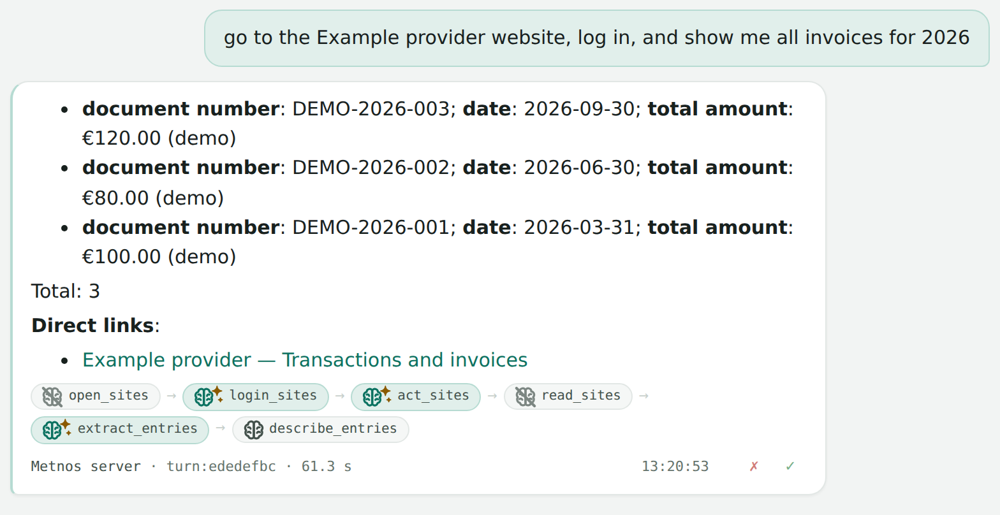
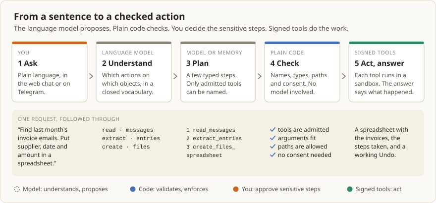
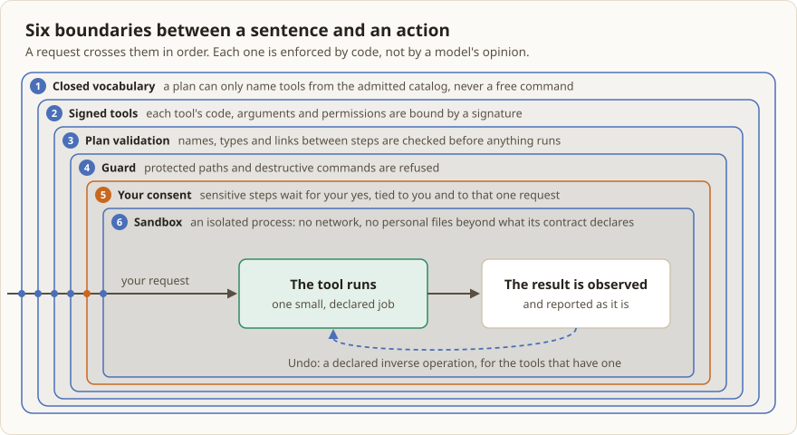
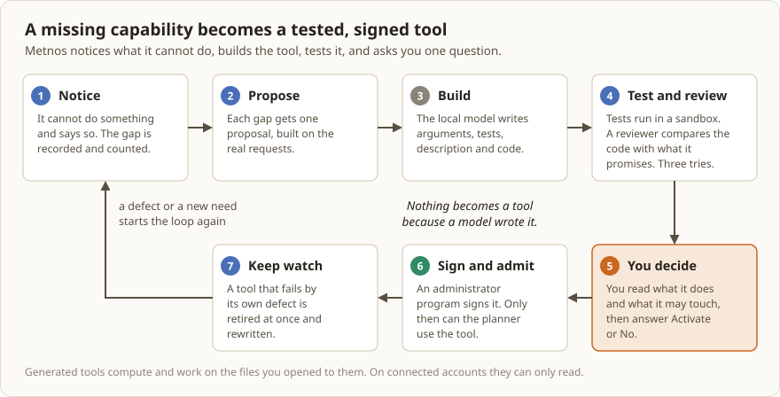
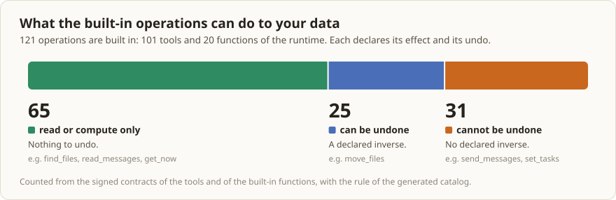

<div align="center">

# Metnos: your self-hosted personal AI assistant

**An AI agent on your own machine, working inside limits you can read.**

Metnos is an open-source, self-hosted personal AI assistant. Its AI agent plans with a
local LLM, acts only through signed, sandboxed tools, and asks before sensitive steps.

[](LICENSE)


[](https://metnos.com)

[Documentation](https://metnos.com) ·
[Quick tour](https://metnos.com/en/Metnos_QuickTour) ·
[Install](install/README.md) ·
[Architecture](https://metnos.com/en/architecture/)

</div>

- **What it is.** A personal assistant you install on a Linux machine you control. You
  talk to it in a web chat or on Telegram.
- **What it does.** It turns one sentence into real work on your files, mail, calendar,
  the web and your PCs, and shows every step it took.
- **Who it is for.** People who want an AI agent that gets things done, and still want
  the last word.
- **Why it is different.** The model only proposes. Every action is a signed tool with
  declared permissions, run in a sandbox. Sensitive steps wait for your yes. When a
  capability is missing, Metnos builds the tool, tests it, and asks you before using it.

<p align="center">
  
</p>

<p align="center"><sub>A real request in the web chat, shown with sample data: one sentence, six tools, and a trace of every step.</sub></p>

## What can you ask a personal AI assistant?

You describe the result. Metnos works out which tools can produce it, how their outputs
connect, where they must run, and which decisions are still yours.

| You say | Metnos does |
|---|---|
| “Find last month's invoice emails and put supplier, date and amount in a spreadsheet.” | Searches the mailbox, extracts the fields and creates the spreadsheet: three tools, one flow of data. |
| “Which of this week's appointments start with ‘Review’?” | Reads the calendar, keeps the appointments whose title starts with that word, and shows them in a table. |
| “Go to my provider's website, log in and show me this year's invoices.” | Opens the site in its own browser, logs in with credentials you saved in a protected form, and reads the documents. |
| “On my laptop, find the PDFs in Documents and zip them.” | Runs those steps on your paired PC. Planning, checks and consent stay on the server. |
| “Every Monday at 8, read unread mail from my work account and send me a summary on Telegram.” | Creates a recurring task and keeps the history of its runs. |
| “Where do I change the model?” | The built-in Tutor answers from the documentation of your own installation, with the exact path in the interface. |
| “Undo the last operation.” | Runs the inverse operation that the tool declared: moved files go back, a created file is removed. |

More examples, area by area, are in the [capability guide](https://metnos.com/en/domains).

## How does the AI agent turn a request into an action?

<p align="center">
  
</p>

The language model works where language helps: it understands what you asked and
proposes a plan. It does not execute anything.

- **A plan is data, not code.** It is a short list of typed steps. Each step names a tool
  from the admitted catalog and gives arguments that fit that tool's contract.
- **Code checks the plan.** A validator that uses no model rejects unknown tools, wrong
  types and broken links between steps before anything runs.
- **The answer follows the evidence.** Counts, partial failures and cut-off results come
  from what the tools returned. Partly done is reported as partly done.
- **Repeated requests are fast.** A request that worked before can reuse its stored
  plan, once that plan is checked against the current tools.

Go deeper: [the request runtime](https://metnos.com/en/architecture/agent_runtime) ·
[planning and plan reuse](https://metnos.com/en/architecture/praxis_engine).

## What makes Metnos different from other AI agents?

- **Private by default: local first, cloud by choice.** Planning runs on a local LLM, or
  on a compatible model server you already run; a GPU helps but is not required.
  Embeddings always run locally. Web search, geocoding and the browser are self-hosted
  services. A cloud model is used only if you choose one and store its key, never as a
  silent fallback.
- **Tool use through a catalog, not a shell.** The agent cannot type commands. It picks
  from tools named with one grammar, `action_object`, such as `find_files`,
  `read_messages` and `create_events`, over a closed vocabulary of about thirty actions
  and thirty objects. There are 121 built-in operations: 101 tools and 20 functions of the
  runtime.
- **It works where your data is.** A small client pairs your Windows or Linux PC. It
  opens no port: it calls the server, verifies each signed job, runs it in the sandbox
  that system offers, and returns a signed result.
- **Long jobs outlive the chat.** Work too long for one turn becomes a supervised job.
  You get a receipt at once, the job resumes after a restart, and the answer arrives in
  the conversation that asked for it. The engine is off until you turn it on in
  Settings, and for now a long job is a single action: it cannot be combined with other
  steps in the same request.
- **It explains itself.** Ask “where do I change the model?” and the built-in Tutor
  answers from the documentation and the tool contracts of your installation. Tutor
  explains; it never acts.
- **One installation, several people.** Each person has their own identity,
  conversations, working folder and paired devices. A guest does not inherit the owner's
  resources.
- **It can learn a new language.** Italian and English are complete. Every text Metnos
  shows or reads is localization data, not code, so Metnos can translate itself. Ask for
  any language at installation: a built-in pipeline translates prompts, tool
  descriptions, messages, the request lexicon, the documentation and Tutor with the
  model, checks every piece, and switches language only when all of them pass. Today an
  administrator starts the pipeline and reviews the sensitive pieces; until it is
  complete the instance works in English.

## How does Metnos compare with OpenClaw and Hermes Agent?

All three are open-source assistants you can run yourself. They differ in where they
place trust.

| | OpenClaw | Hermes Agent | Metnos |
|---|---|---|---|
| **What the agent can run** | Tools run on the host for the main session unless sandboxing is configured; shell commands with approvals and allowlists. | Shell commands checked against dangerous patterns, with approval modes; optional container and remote backends. | Only admitted operations with signed contracts; tools run in a sandbox. No free shell. |
| **New capabilities** | Skills and plugins; the agent can save and update its own skills. | Skills from a hub or written by the agent, freely by default, with optional approval. | The agent builds a tool with its tests; it is reviewed, you activate it, and only then is it signed and admitted. |
| **Undo** | Documented for changes to skills. | `/undo` rewinds the conversation; opt-in checkpoints restore local files. | Each undoable tool declares an inverse operation, also for mail and paired PCs. |
| **Introspection** | Learns its own skills, with change history. | A learning loop: memory, skill creation and improvement, a curator that archives unused skills. | Records what it cannot do, scores every tool and plan, retires and rewrites faulty generated tools, and submits every change for a decision. |
| **Languages** | Not covered in the pages checked. | 17 interface languages, more through language packs. | Italian and English; a built-in pipeline translates the whole product, prompts and request lexicon included. |

Both projects reach more channels and platforms than Metnos. This table compares
documented design defaults, not quality, and all three projects keep evolving. Sources:
[OpenClaw](https://github.com/openclaw/openclaw) and its
[documentation](https://docs.openclaw.ai/);
[Hermes Agent](https://github.com/NousResearch/hermes-agent) and its
[documentation](https://hermes-agent.nousresearch.com/docs/).

## How does Metnos keep an autonomous AI agent safe?

Metnos assumes that a model can be wrong and that generated code can be wrong. Its
security therefore does not depend on the model behaving well. Between a sentence and
its effect there are six boundaries, each enforced by code.

<p align="center">
  
</p>

- **Secrets stay out of the model.** Credentials are encrypted at rest and resolved only
  when a tool runs. They never enter a plan or a prompt.
- **One door for new code.** A new or changed tool becomes usable only through a single
  admission gate that ties checks and approval to the candidate's exact bytes. Copying a
  folder or restarting a service activates nothing.
- **Limits are stated.** On Linux the sandbox is Bubblewrap, and without it ordinary
  tools do not run. On Windows the client uses AppContainer inside a Job Object and
  reports the isolation it actually applied. Network access for a tool is all or
  nothing. A few system services, such as scheduling, run inside the runtime under
  signed contracts of their own. Metnos serves plain HTTP on your private network: do
  not expose it to the Internet.

Go deeper: [sandbox](https://metnos.com/en/architecture/sandbox) ·
[guard](https://metnos.com/en/architecture/vaglio) ·
[consent](https://metnos.com/en/architecture/approval_ux) ·
[the admission gate](https://metnos.com/en/architecture/executor_birth).

## How does a self-improving agent stay under control?

Metnos is introspective: it keeps a record of its own work and acts on it.

- **It knows what it cannot do.** A request that ends with “I cannot do this” is
  recorded as a gap: which action, on which object, how often.
- **It measures its own tools.** Every tool and every plan has a scorecard computed from
  the record of turns: calls, successes, refusals, faults, timings and your ✓ and ✗.
- **It listens to your verdict.** A ✗ removes the stored plan for that request. Repeated
  ✗ on the same pattern become a proposal to avoid it.
- **It repairs and prunes itself.** A generated tool that fails by its own defect is
  retired at once and rewritten. One that nobody uses is set aside.
- **It never changes itself in silence.** Every improvement is a typed proposal with its
  origin, reason and state, visible in the Changes page. Applied changes are observed
  and can be rolled back.

<p align="center">
  
</p>

When a request ends with “I cannot do this”, Metnos records what was missing. If the
gap is real, it builds the tool by itself, in a quiet moment, with the local model: name,
arguments, tests written from the real requests, description and code. The candidate
runs against its tests in a sandbox, and a reviewer compares what the description
promises with what the code does. After three failed attempts Metnos stops. Whether an
external model may help is your choice: never, always, or ask each time.

This is self-improvement with a human in the loop. You answer one question, about
something finished and tested: **Activate** or **No**, in the web page or on Telegram.
Only after your yes is the tool signed, by a separate administrator program that holds
the keys and that generated tools cannot reach.

A generated tool that fails because of its own code is retired at once and sent back to
be rewritten. One that nobody uses is set aside and can be reactivated. What generated
tools may touch is narrow: they compute and work on the files you opened to them, and on
connected accounts they can only read.

Planned: activation without a question for tools that only read or compute, or whose
effects can be undone.

Go deeper: [the cycle of a generated tool](https://metnos.com/en/architecture/lifecycle).

## What can be undone?

<p align="center">
  
</p>

Undo is not a model improvising a repair. A tool that can be undone declares its inverse
operation in its signed contract, and Metnos records exactly what each run touched.
“Undo the last operation” runs that inverse on the same account and the same device.

What cannot be undone, such as a sent email, is marked as such. Metnos says so instead
of pretending. The [tool catalog](https://metnos.com/en/architecture/executor_catalog)
lists each tool with its effect; the [capability guide](https://metnos.com/en/domains)
lists every operation.

## What does it connect to?

- **Files and documents:** folders, text, PDF, spreadsheets, documents, archives, OCR.
- **Mail, calendars, contacts** and scheduled tasks.
- **Google Workspace:** mail, calendar, Drive, Docs, Sheets, contacts and Photos.
- **GitHub:** files, issues, pull requests, comments and workflows.
- **The web:** search, pages and PDFs, and a controlled browser for sites that need a login.
- **Places and photos:** geocoding, nearby places, and a local photo index.
- **Your PCs:** files, installed programs and running processes on paired devices.

Each connection is optional. Without its credentials or its service, that capability is
shown as unavailable and nothing else breaks.

## Quick start

Metnos installs on Linux x86-64 with systemd and Python 3.12.

```bash
git clone https://github.com/brunialti/metnos.git
cd metnos
bash install/bootstrap.sh --check
bash install/bootstrap.sh
```

Install the system packages first: the [installer guide](install/README.md) has the
command.

The installer asks for administrator access, creates a dedicated `metnos` service
account and runs six phases that can be resumed: dependencies, models and companion
services, verified source and Tutor catalog, encrypted credentials, system services,
first access. At the end it prints the address of this server and a one-use first-access
link.

```bash
systemctl list-units 'metnos*'
curl http://127.0.0.1:8770/agent/health
```

Open the printed link on the server, or a printed address from another device on the
same trusted private network. Then send one harmless real request, such as “What time is
it, and which time zone are you using?” A health answer proves that the server started;
the answer in the chat proves that planning and execution work together.

Requirements, options, model endpoints and existing services are in the
[installer guide](install/README.md), also in [Italian](install/INSTALL.md).

## FAQ

**Is Metnos free and open source?**
Yes. Metnos is released under the MIT license. This repository holds the code, the
installer and the portable certification tests.

**Can it run without the cloud? Do I need a GPU?**
Yes, it runs with a local LLM. A GPU makes a local model faster but is not required. You
can also point Metnos to a model server you already run, or choose a cloud model.

**Where does my data go?**
With a local model, your requests are planned on your machine. Metnos contacts the
outside only to do what you asked, such as reaching your mail server, a website or an
account you connected, or to call a cloud model if you configured one.

**How is it different from a chatbot, or from an agent with a terminal?**
A chatbot answers; Metnos acts. An agent with a terminal can run whatever the model
writes; Metnos can run only admitted tools, each with a signed contract and a sandbox.

**What happens if the model gets it wrong?**
A wrong plan is rejected by validation, stopped by the guard, or waits for your consent.
If an undoable tool made a change, you can undo it. The boundaries limit what a mistake
can do; they do not make mistakes impossible.

**Can I add my own tools?**
Yes. A tool is a small program with a manifest that follows the
[Executor Standard](EXECUTOR_STANDARD.md), and it enters through the same admission gate
as every other tool. External skills can be imported the same way. There is no generic
passthrough for external tool servers such as MCP: an external tool has to become an
admitted tool.

**Which systems and languages are supported?**
The server runs on Linux x86-64. Paired PCs can be Windows or Linux. Italian and English
are complete; other languages are produced by the built-in localization pipeline.

## Documentation

- [Quick tour](https://metnos.com/en/Metnos_QuickTour): the product through one real request.
- [Capability guide](https://metnos.com/en/domains): what to ask, area by area.
- [Architecture guide](https://metnos.com/en/architecture/): request flow, memory, Tutor,
  devices and security, with diagrams.
- [Long jobs](https://metnos.com/en/system/lre) · [Models](https://metnos.com/en/system/models) ·
  [Paired devices](https://metnos.com/en/architecture/remote_executors) ·
  [Tutor](https://metnos.com/en/architecture/tutor).
- [Executor Standard](EXECUTOR_STANDARD.md): the contract every tool must satisfy.
- [Roadmap](https://metnos.com/en/roadmap): what is done, in progress and planned.

## Contributing

Issues and patches are welcome. Include the failing request, the platform, the result
you observed, and logs with secrets removed.

This repository is an export of the source needed to run and verify Metnos. Credentials,
private state and development-only material are excluded and scanned for before
publication.

## License and credits

[MIT](LICENSE), copyright (c) 2026 the owner.

The name joins two Greek words for mind: *mētis*, the mind that adapts, and *noûs*, the
mind that reasons.

The optional reCAPTCHA image-grid classifier is
[recaptcha-classification-57k](https://huggingface.co/DannyLuna/recaptcha-classification-57k)
by DannyLuna, MIT license. It is not part of this repository: the installer offers to
download it from Hugging Face, and without it image grids are left to you.

Third-party libraries, companion services and downloaded models retain their own
licenses. The Metnos license does not replace their terms; check those terms before
using or redistributing the corresponding components.
