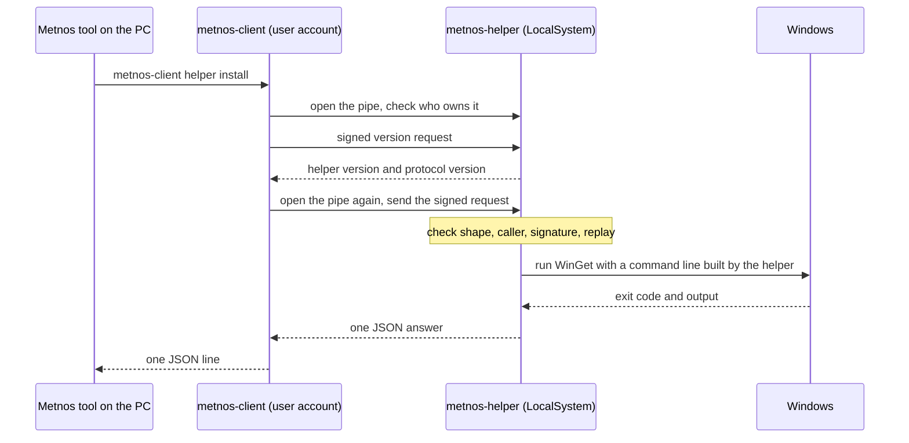

# metnos-helper

`metnos-helper` is a small Windows service. It does a fixed set of
administrator-level jobs for the Metnos client.

The client (`metnos-client`, see [client-rs](../client-rs/README.md)) runs as
the logged-in user and has no administrator rights. When a Metnos tool has to
install a program for all users, start a program as the system, or read
hardware sensors, the client asks the helper to do it.

The helper works only on Windows. On other systems `install`, `uninstall` and
`serve` print a message and exit.

## What it does

The helper accepts four kinds of request: package, managed start, managed stop
and managed provider. Each is a JSON object with fixed fields.

| Request | What the helper does |
|---|---|
| Package `query` | Asks WinGet whether one exact package is installed. Changes nothing. |
| Package `install` | Installs one exact package with WinGet, for all users. |
| Package `uninstall` | Removes one exact package with WinGet. |
| Package `version` | Reports the helper's version and protocol version. If the client adds its own version, the helper also checks the server for a signed update. |
| Managed start | Starts the program of one installed portable WinGet package: now only (`session`), or now and at every system start (`persistent`). |
| Managed stop | Stops one process that a managed start created. |
| Managed provider | Reads hardware sensors through a .NET assembly that belongs to one installed package. Read-only. |

## What it does not do

- A request cannot carry a command line, a path, an executable name, a script
  or free arguments. A request with an unknown field is rejected.
- It does not listen on the network. The only way in is a local named pipe.
- It opens one kind of outgoing connection: the update check, to the server
  address stored at installation. The address may start with `http://` or
  `https://`; a download is accepted only if its signature and hash match.
- It obeys one Windows account: the one it was installed for.
- It knows one package source: WinGet.
- It handles one request at a time.

## Install

```text
metnos-client helper setup
```

Run it once on the Windows PC, logged in as the user who runs the Metnos
client, after the client has been paired with a server. Windows shows its
administrator prompt once.
The command prints one JSON line: `"installed": true`, or an `error_code`.

What `setup` does:

1. The client asks the paired server for the helper descriptor at
   `/agent/component/helper/update/x86_64-pc-windows-gnu`.
2. It verifies the server's Ed25519 signature on the descriptor with the server
   key it pinned at pairing. It checks that the descriptor is for the component
   `helper` and for this system.
3. It downloads the file, checks its SHA-256 against the signed value, and
   saves it in the `staging` folder of the client's data directory.
4. It checks the hash again and asks Windows to run
   `metnos-helper.exe install ...` as administrator.

What `metnos-helper.exe install` does:

1. Checks the four values it received (see the table below).
2. Stops the service if it is already running.
3. Copies itself to `%ProgramFiles%\Metnos\metnos-helper.exe`.
4. Registers the service `MetnosHelper` (display name "Metnos helper"): automatic
   start, account `LocalSystem`, restart after a failure.
5. Adds "Metnos helper" to the list of installed programs. If this step fails,
   the installation is undone.
6. Writes `pairing.json` and starts the service.

Installing the client does not install the helper. Metnos can run `setup` for
you: when you ask it to install a program for all users and the helper is
missing, the confirmation offers a choice that adds the helper first.

Running `setup` again installs the published helper over the existing one and
keeps the pairing, as long as the owner and the device key are the same.

### Manual installation

From an administrator Command Prompt:

```text
metnos-helper.exe install --owner-sid <SID> --public-key <key> --server-key <key> --server-url <address>
```

| Option | Value | Where to find it |
|---|---|---|
| `--owner-sid` | SID of the Windows account the helper will obey | `metnos-client whoami`, line `owner SID` |
| `--public-key` | The client's Ed25519 public key, 64 hex characters | `metnos-client whoami`, line `public key` |
| `--server-key` | The server's Ed25519 public key, base64url, 43 characters | `server_public_key` in `state.json`, in the `data dir` that `whoami` prints |
| `--server-url` | Server address, starting with `http://` or `https://` | `metnos-client whoami`, line `server` |
| `--error-file` | Optional. A file where the reason of a failure is written | |

Exit codes of `install`: `0` done; `2` wrong arguments or pairing refused; `3`
a step failed; `4` installed, but the service did not start within ten seconds
(it starts at the next boot).

The helper has two more commands. `status` says whether it is installed and
for which owner. `serve` is the service loop; Windows starts it. The helper's
own console messages are in Italian.

## Remove

Open **Settings > Apps**, choose "Metnos helper" and uninstall it. Or, from an
administrator Command Prompt:

```text
"%ProgramFiles%\Metnos\metnos-helper.exe" uninstall
```

Metnos is not needed to remove the helper.

| Removed | Left in place |
|---|---|
| The service `MetnosHelper` | `audit.log` |
| `pairing.json` and `consumed.log` | The executable in `%ProgramFiles%\Metnos` |
| The entry in the list of installed programs | Scheduled tasks created by a `persistent` start |

A helper that is already paired does not accept a different owner or device
key: `install` answers `already_paired`. Uninstall it first, then install it
again.

## How the client talks to it



Metnos tools do not open the pipe. They run these client commands, and each
prints one JSON line as the last line of its output:

```text
metnos-client helper check
metnos-client helper query     --package-id <id>
metnos-client helper install   --package-id <id> [--version <version>]
metnos-client helper uninstall --package-id <id>
metnos-client helper start     --package-id <id> --lifetime session|persistent
metnos-client helper stop      --package-id <id> --pid <pid> --creation-time <time>
```

Sensor reads have no command. The client sends them itself, when the signed
manifest of the tool it is about to run declares them.

### The channel

- A Windows named pipe: `\\.\pipe\metnos-helper-<owner SID>`.
- The pipe's access list has one entry: the owner's SID.
- Remote clients are rejected. Only one instance of the pipe can exist; if the
  name is already taken, the helper does not start listening.
- One connection carries one request and one answer. The helper creates a new
  pipe for the next one.
- A message is one line of JSON that ends with a newline. A request can be at
  most 8 KiB.
- The helper waits at most 30 seconds for the request, and at most 30 seconds
  for the client to take the answer.

### What the client checks before it writes

1. The pipe name is local (`\\.\pipe\...`).
2. The pipe object is owned by `LocalSystem` or by the Administrators group.
3. When Windows lets the client see the process at the other end, its
   executable is `%ProgramFiles%\Metnos\metnos-helper.exe`.

If a check fails, the client sends nothing.

### What the helper checks on every request

In this order. The first failure ends the request with an error code.

1. Windows tells the helper which account opened the pipe.
2. The message is one of the known request shapes (`malformed_request`).
3. `pairing.json` and `consumed.log` can be read (`not_paired`,
   `journal_unavailable`).
4. Every field has the expected form: package id, version, idempotency key and
   so on (`malformed_...`).
5. The caller's SID is the owner's SID (`untrusted_signature`).
6. The Ed25519 signature matches the client key stored at installation
   (`untrusted_signature`).
7. For a managed provider: the server's signature on the grant matches the
   server key stored at installation (`untrusted_provider_grant`).
8. The idempotency key (32 hex characters, new for every request) has not been
   used before (`replayed_request`).

Then the helper writes the key to `consumed.log`, carries out the request, and
adds a line to `audit.log`. Refused requests are logged too.

The signature covers the request's fields in a fixed order, joined by the
character U+001F. Start, stop and provider requests begin with their own fixed
label, so a signature made for one kind is not valid for another.

### The answer

| Field | Meaning |
|---|---|
| `ok` | `true` when the request was carried out |
| `error_code` | The reason, when `ok` is `false` |
| `exit_code` | WinGet's exit code, for package operations |
| `detail` | The last lines of WinGet's output, or a short reason |
| `payload` | The data of a start, stop or sensor request |
| `helper_version`, `protocol_version` | Always present |

The client adds `client_version`, `client_protocol_version`, `version_current`
and `aligned` before it prints the line.

## How each request is carried out

### Package operations

The helper builds the WinGet command line itself. The package id and the
version are the only values taken from the request.

| Operation | Command |
|---|---|
| `query` | `winget list --id <id> --exact --accept-source-agreements --disable-interactivity` |
| `install` | `winget install --id <id> --exact --accept-source-agreements --disable-interactivity --accept-package-agreements --silent --scope machine` |
| `uninstall` | `winget uninstall --id <id> --exact --accept-source-agreements --disable-interactivity --silent` |

`--version <version>` is added when the request has one. A package id is 1 to
128 characters, starts with a letter or a digit, and contains only letters,
digits and `. _ + : - @`. `ok` is true when WinGet exits with `0`; `detail`
holds the last lines of its output.

### Managed start and stop

The request names a package, never a file. The helper finds the program in the
machine-wide list of installed programs in the Windows registry:

- the entry must carry that WinGet package id and the installer type `portable`;
- the executable is the registered target, or the only `.exe` under the install
  folder; no `.exe` or more than one is a refusal;
- the executable must be inside the install folder.

`session` starts the program once. `persistent` creates a scheduled task named
`Metnos Managed <24 hex characters>` that runs the program at every system
start, as `SYSTEM`, and starts the program through that task. In both cases the
program runs under the system account. If it is already running, the helper
does not start it again.

A `session` start returns the process id and its creation time. A stop request
must carry both. The helper stops the process only if the id, the creation time
and the executable all match. If the process no longer exists, the answer is
`ok` and nothing is stopped.

### Hardware sensors

A managed provider request names a package, a DLL file name, a .NET type name,
and the hardware domains and sensor kinds wanted. These values are covered by
a grant that the server signs for one invocation of one tool. The helper
requires the server's signature on the grant and the client's signature on the
request.

The DLL must be a file directly inside the package's install folder. The helper
runs Windows PowerShell with a script that is part of the helper. The script
loads the DLL, creates the named type, turns on the requested domains, reads
the sensors and prints them as JSON.

Limits: 8 seconds, 64 KiB of output, 32 sensors. The helper returns only
sensors of the requested domains and kinds, each with the unit fixed for its
kind.

## Updates

The helper does not check for updates by itself. Before every operation the
client asks the helper for its version. This uses no network. If the helper is
older than the client, the client repeats the question and adds its own
version. The request carries nothing else: the server address and the server
key come from `pairing.json`. Then the helper:

1. Asks the server stored in `pairing.json` for the signed descriptor (same
   address as in `setup`).
2. Verifies the signature with the server key stored in `pairing.json`.
3. Checks that the descriptor is for the component `helper`, for this system,
   and for a version strictly higher than its own.
4. Downloads the file (at most 64 MiB) and checks its SHA-256.
5. Renames the running executable to `metnos-helper.old` and puts the new file
   in its place. If that fails, the old file is put back.
6. Exits. Windows restarts the service after a few seconds, and the new
   version runs.

The client waits a few seconds and asks for the version again. If the helper
is still older, the client answers `helper_update_pending` and does not send
the operation.

## Files, registry and logs

| Where | What |
|---|---|
| `%ProgramFiles%\Metnos\metnos-helper.exe` | The installed program |
| `%ProgramFiles%\Metnos\metnos-helper.old` | The previous program, after an update |
| `%ProgramData%\Metnos\helper\pairing.json` | Owner SID, client public key, server public key, server address, time of consent |
| `%ProgramData%\Metnos\helper\consumed.log` | Idempotency keys already used, one per line. The newest 10,000 are kept |
| `%ProgramData%\Metnos\helper\audit.log` | The log (see below) |
| `%ProgramData%\Metnos\helper\metnos-helper.new` | An update while it is being downloaded |
| `HKLM\Software\Microsoft\Windows\CurrentVersion\Uninstall\MetnosHelper` | The entry in the list of installed programs |
| Service `MetnosHelper` | The helper itself |
| Scheduled tasks `Metnos Managed ...` | Created by `persistent` starts |

`audit.log` has one line per event and four fields separated by tabs: the time
in Unix seconds, the event (`paired`, `executed` or `refused`), the package id,
and a short detail such as the WinGet exit code or the refusal code. Lines are
only added, never rewritten.

## Build from source

```bash
cd helper-rs
cargo test
cargo build --release --target x86_64-pc-windows-gnu
```

`cargo test` runs on any system. The modules that call Windows (`src/win_*.rs`)
are compiled only on Windows. Building for Windows from Linux needs the Rust
target `x86_64-pc-windows-gnu` and mingw-w64.

Release binaries are built, signed and placed in the server's download folder
by [`scripts/build-client.sh <version>`](../scripts/build-client.sh), together
with the client. The script stops unless `helper-rs/Cargo.toml` and
`client-rs/Cargo.toml` both declare that version.

Libraries used: `serde`, `serde_json`, `ed25519-dalek`, `sha2`, `hex`,
`base64`, `ureq` with `rustls` (update check only), and `windows-sys`.

## Troubleshooting

Start here, in a Command Prompt:

```text
metnos-client helper check
"%ProgramFiles%\Metnos\metnos-helper.exe" status
sc.exe query MetnosHelper
```

Then read the last lines of `%ProgramData%\Metnos\helper\audit.log`.

| What you see | What it means | What to do |
|---|---|---|
| `helper_not_available` | The pipe cannot be opened: the helper is not installed, the service is not running, or the client runs as a different account than the owner | Check the service; run `metnos-client helper setup` |
| `pipe_not_local`, `peer_not_local_system`, `peer_unexpected_executable` | The client did not find the installed helper at the other end and sent nothing | Check that the service `MetnosHelper` is running; reinstall the helper if it is not |
| The service is registered but stops at once | There is no `pairing.json`, or another process already holds the pipe name | Run `status`; if it reports no pairing, run `setup` again |
| `not_paired` from `setup` | The client is not paired with a server | Pair the client first |
| `consent_refused` from `setup` | The Windows prompt was answered "No" | Run `setup` again and accept |
| `fetch_failed` from `setup` | The download or one of its checks failed; `detail` says which | Check that the server is reachable and publishes a helper |
| `install_failed` from `setup` | `metnos-helper.exe install` failed; `exit_code` and `detail` say where | See the exit codes above |
| `already_paired` | The helper is paired with another owner or device key | Uninstall, then install again |
| `untrusted_signature` | The caller is not the owner, or the client's key is not the one stored at installation | Use the owner's account; if the client's key changed, uninstall and install again |
| `replayed_request` | The same idempotency key was sent twice | Send a new request |
| `not_paired`, `journal_unavailable`, `journal_write_failed` from a request | `pairing.json` or `consumed.log` cannot be read or written | Check the files in `%ProgramData%\Metnos\helper` |
| `helper_update_pending` | The helper is older than the client and did not update | Look for `update_refused: <reason>` in `audit.log` |
| `helper_update_refused` | The update check failed; `detail` is the reason, for example `descriptor_unreachable`, `untrusted_signature`, `wrong_target`, `artifact_hash_mismatch` | Check the server address in `pairing.json` and that the server publishes a helper |
| `package_operation_failed` | WinGet exited with an error; see `exit_code` and `detail`. A `detail` that starts with `spawn_failed` means WinGet could not be started | Check that WinGet (App Installer) is present on the PC |
| `package_not_registered`, `package_start_unsupported` | The package has no machine-wide registration, or it is not a portable package | Managed start works only for portable WinGet packages installed for all users |
| `package_target_missing`, `package_target_ambiguous`, `package_target_invalid` | The helper could not pick exactly one executable inside the package folder | Check the package's install folder |
| `package_process_identity_mismatch` | The process id now belongs to a different process | Nothing was stopped |
| `provider_...` | The sensor read failed; the code names the step (load, open, read, timeout, output) | Check that the package and its DLL are installed |

The helper looks for `winget.exe` in the `Microsoft.DesktopAppInstaller_...`
folders under `%ProgramFiles%\WindowsApps` and uses the last one in name order.
If it finds none, it runs `winget.exe` by name.

## Source layout

| File | Role |
|---|---|
| `main.rs` | Entry point; runs `install`, `uninstall`, `status`, `serve` |
| `cli.rs` | Command-line parsing |
| `protocol.rs` | Request and answer types, field checks, WinGet command lines, signed text |
| `pairing.rs` | Pairing file, signature checks, order of the checks, data paths |
| `journal.rs` | Used idempotency keys |
| `audit.rs` | The log |
| `service.rs` | One request from authorization to log line |
| `channel.rs` | Pipe name and SID check |
| `frame.rs` | Message framing; identical to `client-rs/src/frame.rs` |
| `setup.rs` | Service, registry and pairing values used by `install` and `uninstall` |
| `selfupdate.rs` | Signed update check and download |
| `activation.rs` | Choice of the executable for a managed start |
| `provider.rs` | Checks on the sensor output |
| `win_pipe.rs` | Named pipe, access list, caller SID |
| `win_serve.rs` | Service loop; runs WinGet |
| `win_service.rs` | Windows service control |
| `win_setup.rs` | File copy, `sc.exe`, `reg.exe`, executable replacement |
| `win_activation.rs` | Registry lookup, process start and stop, scheduled task |
| `win_provider.rs` | Sensor read through Windows PowerShell |

On the client side the pipe is handled by `client-rs/src/helper_client.rs`
(the checks), `client-rs/src/helper_win.rs` (the Windows calls) and
`client-rs/src/helper_setup.rs` (download and installation).

## License

MIT. See [LICENSE](../LICENSE).
